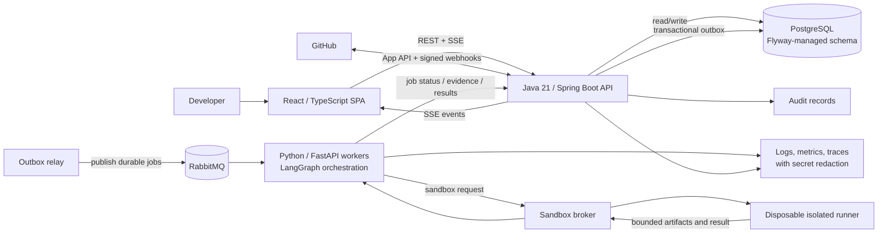
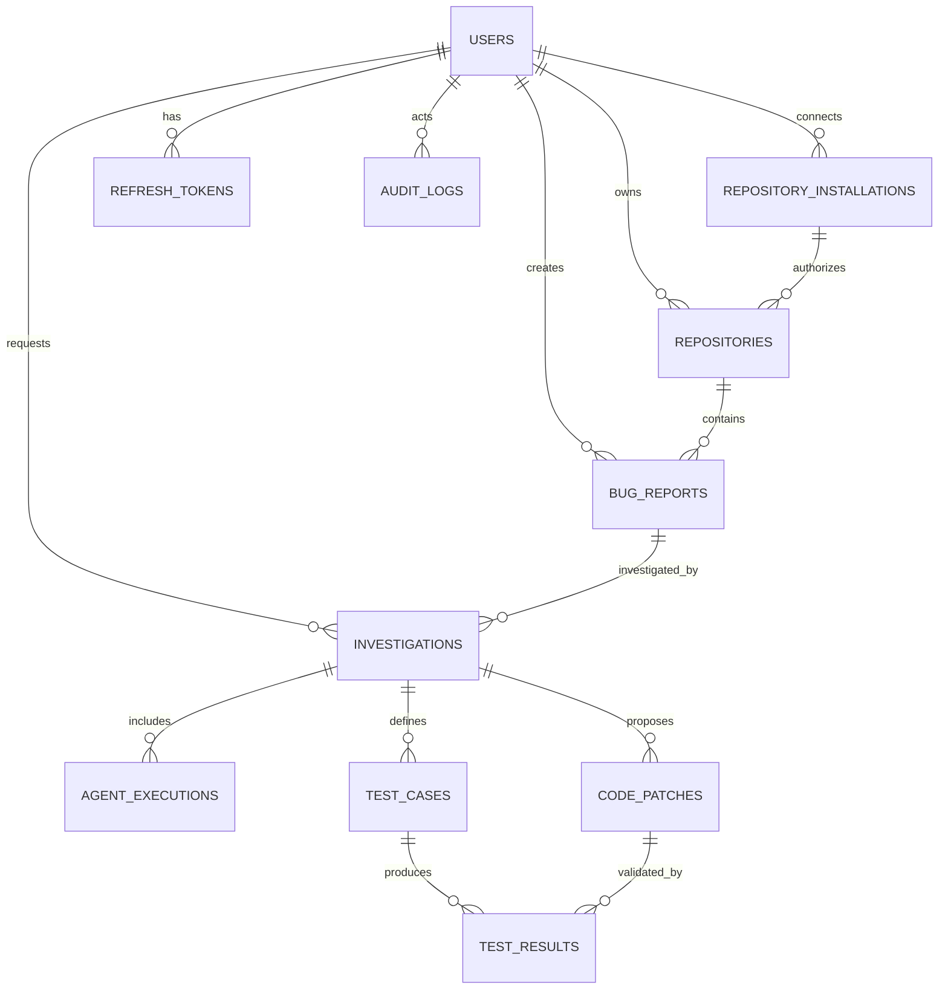
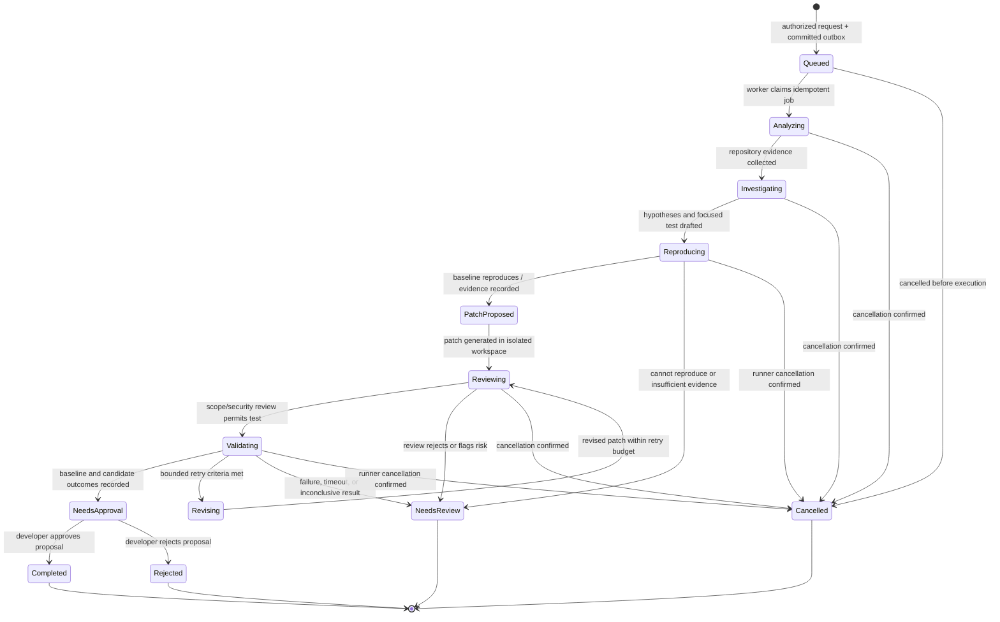

# BUGDETECT AI — Phase 1 Architecture

> **Status: implementation in progress.** This document describes the proposed target architecture. The initial application slice now includes a React UI and Spring Boot API for account registration/session login, locally labeled user-owned repositories, and bug-report tracking backed by Flyway migrations. The target GitHub integration, asynchronous AI workflow, transactional outbox/RabbitMQ, patch approval, and sandbox runner are not implemented. See the [README](../README.md) for what runs today.

## 1. Goals and boundaries

BUGDETECT AI is planned as a developer-facing service that accepts a bug report and an authorized repository, gathers evidence, investigates likely causes, generates reproduction tests, and may propose a scoped code patch. Test execution and patch validation must take place in disposable isolated runners. A developer remains responsible for approving a patch; the system must not merge changes automatically.

The design separates the authoritative product API and state from asynchronous AI work and untrusted code execution:

- The **Java/Spring Boot API** is the system of record for users, authorization, repository connections, bugs, investigations, patches, test state, audit history, and dashboard queries.
- **Python/FastAPI workers** run specialized LangGraph workflows and agents. They request work through durable messages and use constrained, typed contracts.
- **PostgreSQL** stores relational product state. **pgvector is optional**, and is not required for the initial architecture.
- A **transactional outbox** and **RabbitMQ** provide durable asynchronous job delivery.
- A **sandbox broker** schedules work onto disposable isolated runners; API and AI-worker processes do not access the Docker socket.
- A **React/TypeScript single-page application** calls only the Java REST/SSE API. It does not call workers or the database directly.
- A least-privilege **GitHub App** provides repository access and signed webhook events.

### Not in scope for Phase 1

Phase 1 documented decisions and interfaces only. Subsequent implementation has begun with the account/repository-label/bug-report slice described above; Phase 1 did not create that code. CI/deployment resources, cloud resources, GitHub App configuration, and working agent integrations remain unimplemented. Automatic patch merge, unrestricted repository/network access, and claims that an unverified hypothesis is a confirmed root cause are explicitly out of scope.

## 2. System architecture



The broker/runner boundary is intentional: neither the Java API nor an AI worker receives a host container-engine socket or launches an unrestricted container. The broker validates an authorized, bounded job request and dispatches it to the runner environment. Runner results are treated as untrusted input.

### Trust boundaries and data flow

1. A developer authenticates to the API. The API authorizes each operation against the user, repository installation, and resource ownership.
2. Repository connection uses a GitHub App installation and short-lived access credentials. Raw provider tokens are not persisted in product tables.
3. API writes that require asynchronous work persist the resource update and outbox record in the same database transaction. A relay publishes the job to RabbitMQ; consumers must be idempotent.
4. Workers fetch only the job inputs and repository material needed for the task. They return typed, bounded results and evidence references; the API records authoritative state.
5. Any command or test against repository code is submitted to the sandbox broker and executed in a disposable runner. Network access is disabled unless an explicitly reviewed task requires an allowlisted destination.
6. Results and artifacts are stored or referenced through controlled, size-limited storage, scanned/quarantined as appropriate, and subject to retention policy. The database holds metadata and references rather than unbounded logs or binary artifacts.

## 3. Major component choices

| Component | Planned responsibility | Rationale and constraints |
| --- | --- | --- |
| React, TypeScript, Vite | Browser SPA and user workflows | Typed UI, fast local iteration, static deployment. The SPA communicates only with the Java API. |
| Java 21, Spring Boot | Product REST/SSE API and state transitions | Mature authorization, transaction, persistence, and validation ecosystem; one authoritative domain boundary for user-visible state. |
| Python 3.13, FastAPI, LangGraph | Agent orchestration and specialized analysis | Python ecosystem for model/tool integrations and explicit, resumable workflow state. Workers are not a second product API or source of truth. |
| PostgreSQL, Flyway | Relational state, constraints, migrations | Transactions and referential integrity support durable state and the outbox pattern. Schema changes are versioned. |
| pgvector (optional) | Future embedding similarity/search | Optional capability only; core investigation and evidence tracking must work without vector storage. |
| RabbitMQ | Durable asynchronous job transport | Separates request latency from long-running work. Use persistent messages, acknowledgments, retry limits, dead-letter handling, and idempotent consumers. |
| GitHub App | Repository authorization and webhooks | Installation-scoped, least-privilege access and short-lived installation tokens rather than long-lived user PATs. |
| Dedicated sandbox broker and isolated runners | Build/test/analysis of untrusted repository code | Separates execution privileges from application and agent processes. Containers alone are not assumed to be a perfect security boundary. |
| OpenAPI | API contract | Documents the Java API for frontend integration and compatibility checks. |

## 4. Logical data model

All primary identifiers are UUIDs. Persist timestamps in UTC. Use foreign keys, `NOT NULL` where applicable, check constraints for enumerated state, and indexes for foreign keys, ownership filters, status queries, and time-ordered lists. Exact column types, lengths, and retention durations are implementation decisions for a later phase and must be captured in migrations.

| Entity | Purpose and representative fields |
| --- | --- |
| `users` | `id`, normalized unique `email`, `password_hash` (when local-password auth is enabled), display name, account status, created/updated timestamps. Never store plaintext credentials. |
| `refresh_tokens` | `id`, `user_id`, token hash, expiry, rotation/revocation timestamps, creation metadata. Store only a one-way hash of each refresh token; rotate on use and revoke the prior token. |
| `repositories` | `id`, owner/user or tenant scope, GitHub `owner` and `name`, provider/repository identifiers, default branch, installation reference, visibility metadata, connection status, timestamps. Enforce uniqueness for the provider repository identity within its owning scope. |
| `repository_installations` | `id`, owning scope, GitHub App installation identifier, granted permission summary, installation status, timestamps. One installation can authorize multiple repository records. No raw installation access token. |
| `bug_reports` | `id`, `repository_id`, creator, title, description, reproduction details, severity/status, attachment references, timestamps. Bound and validate all user-supplied text and attachment metadata. |
| `investigations` | `id`, `bug_report_id`, requested-by user, workflow status, current step, cancellation/finish timestamps, summary, failure code, timestamps. |
| `agent_executions` | `id`, `investigation_id`, agent kind, attempt number, status, bounded input/output metadata, evidence references, timing, failure category. Do not treat model output as trusted instructions or verified facts. |
| `code_patches` | `id`, `investigation_id`, proposed commit/base identifiers, patch artifact reference, scope summary, review status, approver and decision timestamps. Store patch metadata and controlled references, not unbounded diffs in ordinary relational rows. |
| `test_cases` | `id`, `investigation_id`, source/generator metadata, test name/framework, classification (reproduction/regression), content or controlled artifact reference, status, timestamps. |
| `test_results` | `id`, `test_case_id`, optional `code_patch_id`, sandbox run reference, outcome, bounded summary, exit/status metadata, timing. Distinguish baseline and candidate runs. |
| `audit_logs` | `id`, actor/user or system identity, action, resource type/id, request/correlation ID, timestamp, minimal redacted metadata. Append-oriented; no credentials or unnecessary sensitive payloads. |
| `outbox_events` | `id`, unique event ID, aggregate type/ID, event type, bounded non-secret payload, creation/publication timestamps, attempt count. Written in the same transaction as the state change it announces. |
| `github_webhook_deliveries` | Unique provider delivery ID, event type, accepted/processed timestamps, and processing state for signature-verified webhook deduplication and recovery. Store only the minimum event data needed for processing. |

### Entity relationships



`outbox_events` and `github_webhook_deliveries` are operational persistence supporting reliable delivery and deduplication; they do not represent product-domain relationships, so they are omitted from the ER diagram. Provider token material belongs in an approved secret-management mechanism or short-lived runtime memory, never in `repository_installations`.

### Persistence and consistency rules

- Use database transactions for each state transition and its outbox event. Do not publish a queue message and then assume the database write succeeded, or vice versa.
- Outbox messages have unique event/job identifiers. Consumers record idempotency before applying a result; duplicate delivery must not duplicate an investigation, patch, or test result.
- State changes follow explicit allowed transitions; invalid transitions return a client error and are audited where security-relevant.
- Keep artifact content, raw logs, and large test output in controlled artifact storage with references, size ceilings, access checks, and retention. Do not use database rows as unbounded blob storage.
- A status projection in the API is authoritative. Worker-local workflow state is execution state, not the user's durable source of truth.

## 5. REST and event API

The planned API is versioned under `/api/v1`. The Java service is the only public application API. Publish an OpenAPI contract. JSON errors should use a consistent problem response with a stable error code, safe message, request ID, and field errors when applicable; never expose stack traces, secrets, or internal prompts.

### Endpoint outline

| Area | Method and path | Purpose / expected response |
| --- | --- | --- |
| Authentication | `POST /api/v1/auth/register` | Register a local account if enabled; `201` or validation/conflict error. |
|  | `POST /api/v1/auth/login` | Authenticate and issue short-lived access credentials plus a rotating refresh credential using the selected secure cookie/token policy. |
|  | `POST /api/v1/auth/refresh` | Rotate refresh credential and issue a new access credential. |
|  | `POST /api/v1/auth/logout` | Revoke refresh credential and clear the client credential. |
|  | `GET /api/v1/users/me` | Return the authenticated user's safe profile. |
| Repositories | `GET /api/v1/repositories` | List only repositories authorized for the caller; paginated. |
|  | `POST /api/v1/repositories/connect` | Begin GitHub App installation/authorization; return a short-lived state-bound URL or continuation details. |
|  | `GET /api/v1/repositories/callback` | Validate signed/one-time state and complete the connection; reject replay or mismatch. |
|  | `POST /api/v1/repositories/import` | Import/select repositories already granted to the installation. |
|  | `GET /api/v1/repositories/{repositoryId}` | Read authorized repository metadata and connection status. |
|  | `POST /api/v1/repositories/{repositoryId}/analyze` | Enqueue repository analysis; `202 Accepted` with investigation/job resource. |
|  | `GET /api/v1/repositories/{repositoryId}/status` | Read sync/analysis status. |
| Bug reports | `POST /api/v1/bugs` | Create a report against an authorized repository; `201`. |
|  | `GET /api/v1/bugs` | List authorized reports with filters and pagination. |
|  | `GET /api/v1/bugs/{bugId}` | Read report and safe summary of associated work. |
|  | `PATCH /api/v1/bugs/{bugId}` | Update permitted report fields; enforce ownership/role and state rules. |
|  | `POST /api/v1/bugs/{bugId}/attachments` | Register or upload a bounded attachment through quarantine/scanning controls. |
| Investigations | `POST /api/v1/bugs/{bugId}/investigations` | Start an investigation; persist state and outbox atomically; return `202 Accepted` and investigation ID. Support an idempotency key. |
|  | `GET /api/v1/investigations/{investigationId}` | Read durable current status, progress, evidence links, and report. |
|  | `GET /api/v1/investigations/{investigationId}/events` | Authenticated Server-Sent Events stream. Reconnect using event IDs; clients can always recover via the status endpoint. |
|  | `POST /api/v1/investigations/{investigationId}/cancel` | Request cancellation; return accepted/current state. Cancellation is cooperative and does not claim a running process stopped until confirmed by the broker. |
| Patches | `GET /api/v1/investigations/{investigationId}/patches` | List authorized proposed patches. |
|  | `GET /api/v1/patches/{patchId}` | Read patch metadata, scope summary, and authorized diff/artifact reference. |
|  | `POST /api/v1/patches/{patchId}/approve` | Record explicit human approval for the proposal; does not merge or deploy. |
|  | `POST /api/v1/patches/{patchId}/reject` | Record rejection and optional bounded reason. |
| Tests | `GET /api/v1/investigations/{investigationId}/tests` | List reproduction/regression test cases. |
|  | `GET /api/v1/investigations/{investigationId}/test-results` | List baseline/candidate results with pagination. |
| Dashboard | `GET /api/v1/dashboard/metrics` | Return metrics scoped to the caller's authorized repositories. |
| Webhooks | `POST /api/v1/webhooks/github` | Verify GitHub signature against raw request bytes, validate event/delivery ID, persist/deduplicate event, and acknowledge quickly. |

### Common contract rules

- Use `202 Accepted` for work that continues asynchronously; include the durable resource ID and a status URL. Do not wait for agent or sandbox completion in the request thread.
- Require authorization at the resource level on every repository, bug, investigation, patch, test, artifact, and event-stream request. Opaque UUIDs are not authorization.
- Apply pagination and bounded filters to collection endpoints; include stable ordering and a continuation mechanism.
- Require idempotency keys for retriable create/start operations where duplicate work is costly. Scope key uniqueness to the caller and operation, and persist the result for a documented interval.
- Return request/correlation IDs. Propagate them through outbox events, queue messages, worker logs, sandbox runs, and audit records without including secrets.
- SSE is a notification channel, not the state store. Include event IDs and support reconnect/replay when retained; clients recover gaps by fetching the authoritative status resource.
- Validate all inputs and content types, bound request size, rate-limit sensitive/expensive operations, and return safe errors.
- Webhook handlers verify signatures before processing, deduplicate delivery IDs, persist accepted work, and avoid doing lengthy processing inline.

For example, `POST /api/v1/bugs/{bugId}/investigations` accepts an optional requested branch/ref and bounded investigation options. It requires an authenticated principal and an `Idempotency-Key`; the API verifies access to the bug's repository before creating work. A successful response is `202 Accepted` with a body such as:

```json
{
  "id": "investigation-uuid",
  "status": "QUEUED",
  "statusUrl": "/api/v1/investigations/investigation-uuid",
  "eventsUrl": "/api/v1/investigations/investigation-uuid/events"
}
```

The status resource returns the persisted investigation state and evidence/report references. Typical failure statuses include `400` for malformed input, `401` for missing/invalid authentication, `403` for denied access, `404` for an unavailable resource, `409` for an invalid state or idempotency conflict, `422` for semantically invalid input, and `429` for rate/quota limits. Error bodies use the safe problem format described above.

An SSE progress event carries an event ID and a small state update, for example:

```text
id: event-uuid
event: investigation.progress
data: {"investigationId":"investigation-uuid","status":"ANALYZING","step":"repository-analysis"}
```

The event stream contains no credentials, full prompts, source dumps, or unbounded logs. If a client cannot replay an old event, it fetches the status resource and resumes from current durable state.

## 6. Agent and LangGraph workflow

### Specialized agents

| Agent | Responsibility | Required output discipline |
| --- | --- | --- |
| Repository analyzer | Identify language/framework, layout, build/test commands, and relevant files within the authorized repository | Paths and observations tied to repository evidence; no arbitrary command execution. |
| Bug investigator | Form and rank possible causes from the report, repository evidence, and test output | Hypotheses, supporting/contradicting evidence, confidence, and unknowns. A hypothesis is not a verified root cause. |
| JUnit test generator | Draft a focused reproduction/regression test for a Java project | Test case and rationale conforming to the detected project conventions; test is untrusted until run. |
| Code fixer | Propose the smallest relevant patch in an isolated workspace | Patch/diff, changed-file list, rationale, and explicit scope; no direct write to the user's repository. |
| Code reviewer / security check | Inspect proposed change for correctness, unintended scope, and security-sensitive behavior | Findings tied to exact diff/evidence; must not silently approve. |
| Validation agent | Coordinate baseline and candidate test runs and summarize actual results | Separate baseline from candidate outcome, include run identifiers and limitations; never infer a pass from missing output. |

Agent contracts use validated Pydantic schemas with versioned fields, bounded strings/lists, explicit status and error variants, and evidence references. Evidence should identify the source (for example repository path/line range, test run, or report field), not merely offer an unsupported natural-language assertion. Treat model responses, repository files, issue text, generated tests, and tool output as untrusted data.

### Workflow states and control flow



`Completed` means the investigation workflow produced its intended reviewable result, not that code was merged or deployed. A patch reaching `NeedsApproval` requires an explicit developer decision. The system must report incomplete/failed/inconclusive validation distinctly from passing results.

### Execution sequence

1. API authenticates and authorizes the caller, validates the bug/repository, and stores the investigation plus outbox event atomically.
2. Outbox relay publishes a persistent job. A worker claims it idempotently and records progress through the API.
3. Repository analyzer collects bounded metadata and relevant file evidence. The investigator produces competing, evidence-linked hypotheses and identifies uncertainty.
4. Test generator proposes a focused reproduction test. The broker runs it in a disposable runner against the baseline. If reproduction fails or evidence is insufficient, report that honestly; do not present a cause as verified.
5. Code fixer may propose a minimal patch only in an isolated working copy. Review checks changed-file scope, generated content, and security risks before tests proceed.
6. Validation runs baseline and candidate reproduction/regression tests in separate or reset workspaces. Record actual test commands, exit/outcome metadata, bounded output, image/toolchain identity, and run references.
7. Retry only when a defined retryable condition applies and within a small configured attempt/time/cost budget. Otherwise stop as failed or inconclusive with evidence.
8. Present the report, patch, and test outcomes for developer review. Approval records a decision only; no automatic commit, merge, or deployment occurs.

## 7. Frontend page structure

The SPA is organized around authenticated developer tasks. It consumes typed API contracts and uses REST for durable state and SSE for live progress.

| Page / route concept | Principal content and actions |
| --- | --- |
| Login / registration | Local account entry where enabled; clear auth errors and safe recovery behavior. |
| Dashboard | Authorized repositories, open bug reports, investigation status, recent results, and scoped metrics. |
| Repositories | Connected repository list, GitHub App connection/import flow, connection status, and repository detail. |
| Bug reports | Paginated/filterable list; create/edit report; attachment upload through the API's bounded quarantine flow. |
| Bug report detail | Description, reproduction information, related investigations, and an explicit start-investigation action. |
| Investigation detail | Durable state, agent activity, evidence-linked hypotheses, failures/limitations, and reconnectable progress stream. |
| Report / evidence | Findings with supporting/contradicting evidence and uncertainty; distinguish suggested cause from verified test behavior. |
| Patch comparison / approval | Changed-file summary and diff reference, review status, test evidence, and explicit approve/reject actions. No merge action. |
| Test results | Baseline/candidate test cases and outcomes, run metadata, and bounded failure output. |
| Settings | Account/security settings and connected repository installation information visible to the caller. |

Route guards improve navigation UX but are not security controls. The API independently enforces every authorization decision. Render untrusted reports, repository content, diffs, and logs as escaped text; do not execute or interpret them as HTML.

## 8. Backend project structure

### Java API (feature-oriented packages)

```text
<java-root>/
  auth/              registration, login, refresh rotation, logout
  users/             user profile and account state
  repositories/      repository records, GitHub App connection and import
  bugs/              bug reports and attachment metadata
  investigations/    lifecycle, status, cancellation, report and SSE
  agents/             worker-facing contracts and job/outbox integration
  patches/            patch metadata and human approval/rejection
  tests/              test cases and result projections
  dashboard/          authorized aggregate queries
  audit/              append-oriented audit events
  config/             security, persistence, messaging, API configuration
  common/              request IDs, errors, pagination, validation utilities
```

Each feature should own its API models, application/service logic, persistence mapping, and authorization checks as appropriate. Avoid a package structure that couples all controllers, services, and repositories by technical layer. `common` is for genuinely shared cross-feature primitives, not a second general-purpose domain layer.

### Python worker service

```text
<python-root>/
  app/
    api/              health/internal callbacks only; no replacement public product API
    orchestration/    LangGraph graph, state, transitions, checkpoints
    agents/           repository analyzer, investigator, test generator,
                      code fixer, reviewer, validator
    tools/            constrained repository and sandbox-broker client tools
    providers/        model/provider adapters and retry policy
    schemas/          versioned Pydantic job, evidence, and result contracts
    messaging/        RabbitMQ consumer, acknowledgment, idempotency, DLQ
    observability/    redacted structured logs, metrics, trace context
```

Worker identity and endpoints must be authenticated service-to-service. Workers return results to the Java API or a contractually defined result channel; only the API commits authoritative product state. LangGraph checkpoints and prompts are subject to the same retention, access, and secret-redaction controls as other operational data.

## 9. Security model

### Identity, authorization, and credentials

- Hash local passwords with Argon2id (preferred) or an appropriately configured bcrypt implementation. Use generic login errors and rate limits.
- Use short-lived access JWTs with fixed algorithms, issuer/audience checks, and key rotation. Rotate refresh tokens on use and persist only hashed refresh-token values.
- Prefer secure, `HttpOnly`, `SameSite` cookies for browser refresh credentials with CSRF protection as applicable; define access-token storage and CSRF behavior consistently before implementation. Never place long-lived credentials in browser local storage.
- Apply Spring Security authorization at both route and resource level. Verify repository ownership/installation scope for every operation, including SSE, patch diffs, attachments, and dashboard queries.
- Use a GitHub App with only required permissions, installation-scoped repository selection, signed webhooks, short-lived installation tokens, and timely revocation. Never log or persist raw provider tokens.
- Keep signing keys, webhook secrets, database credentials, and model-provider credentials in a secret manager or protected runtime environment; never commit them or include them in prompts, errors, or telemetry.

### Untrusted input, agents, and web content

- Treat user reports, repository files, dependency scripts, comments, model output, tests, and command output as hostile input. Prompt instructions embedded in repository content cannot grant permissions or override system policy.
- Give each agent only the tools and data needed for its role. Expose typed operations, not arbitrary host shell, unrestricted HTTP, or secret-bearing environment.
- Validate structured model outputs and independently check paths, diff scope, file types, command policy, and result provenance. Model confidence is not a security or correctness proof.
- Limit outbound network access, tool calls, file reads/writes, runtime, output size, and model retries/cost. Require human approval for proposed code changes.

### Transport, operations, and data lifecycle

- Require TLS for external and service-to-service connections; configure explicit CORS origins, secure headers, CSRF defenses where cookie auth is used, request-size limits, and rate limits.
- Redact credentials and sensitive payloads from application, model, queue, tracing, and sandbox logs. Avoid logging full prompts, source files, or patch contents by default.
- Maintain auditable security-relevant events with actor, action, target, request ID, timestamp, and minimal redacted metadata. Define retention/deletion policies for reports, source-derived artifacts, logs, checkpoints, and backups before launch.
- Pin and scan dependencies and runner images; generate an SBOM, sign/release artifacts, protect build credentials, and review model/tool/provider changes.
- Keep production secrets and workloads isolated by environment and least-privilege service identities. Back up PostgreSQL and test restoration as a later operational milestone.

## 10. Sandbox design

Repository builds and tests execute in disposable, broker-managed runners, not in the API process or directly inside an agent worker. Each job receives a narrowly scoped workspace and is destroyed after result/artifact collection.

Required runner controls:

- Use a pinned, allowlisted base image and controlled toolchain versions; prohibit arbitrary privileged images.
- Run as a non-root identity with read-only root filesystem, a bounded writable temporary workspace/tmpfs, dropped Linux capabilities, and seccomp plus AppArmor (or equivalent platform controls).
- Enforce CPU, memory, process/PID, disk, wall-clock, and output limits; terminate timed-out jobs and cap concurrent work per user/tenant.
- Disable network by default. When an approved workflow needs dependency retrieval, use an explicit allowlist/proxy and do not expose credentials to build scripts.
- Mount no host home directories, Docker/container-engine sockets, cloud metadata endpoints, application secrets, or unrelated repositories. Do not reuse a writable workspace across tenants or jobs.
- Treat all runner output and artifacts as untrusted; bound and scan them, verify expected paths/types, and collect only declared outputs.
- Ensure cancellation, timeout, and failure paths still clean up runner resources and temporary data; record broker-side completion/cleanup status.

Container hardening reduces risk but does not make arbitrary code safe. For public or otherwise highly untrusted repositories, prefer a stronger VM/microVM boundary or a runtime such as gVisor/Kata where supported, in addition to the controls above. Keep the broker's control plane separate from the runner data plane and do not give model workers direct runner-administration privileges.

## 11. Milestones: 13-phase roadmap

These are planned milestones, not evidence that any phase has shipped. Later phases may be re-ordered only after revisiting dependencies and threat assumptions.

**Implementation checkpoint:** the first application increment is in progress. Account registration, cookie-backed session login, a local per-user repository label, and basic bug-report create/list/detail/status operations are implemented. The schema currently contains users, repositories, and bug reports. The local repository label is not a GitHub App installation. PostgreSQL is configured as a supported datasource, but the current persistence tests use H2. JWT/refresh-token rotation, durable async jobs/outbox, investigations, agents, patches, GitHub webhooks, and sandbox execution are still planned and must not be presented as working features.

| Phase | Milestone | Exit evidence |
| --- | --- | --- |
| 1 | Architecture and system design | Architecture, trust boundaries, logical schema, API outline, workflow, security/sandbox design, risks, and phased plan reviewed. |
| 2 | Database and backend foundation | Java service skeleton, PostgreSQL/Flyway baseline, core entities/constraints, health checks, and transactional outbox behavior covered by tests. |
| 3 | Frontend foundation and authentication | React/TypeScript routes and auth flow integrated with API; resource authorization and credential/CSRF behavior tested. |
| 4 | GitHub App integration | Installation/connect/import flow and signature-verified, deduplicated webhooks work with minimal permissions and no persisted raw tokens. |
| 5 | Repository analysis | Authorized repository metadata/layout detection and evidence references are returned under bounded access. |
| 6 | Agent orchestration | Python worker contracts, durable queue consumption, LangGraph state, idempotency, retries, and observability are integrated. |
| 7 | Bug investigation | Bug report intake, investigation lifecycle, evidence-linked hypotheses, status API, and reconnectable progress are available. |
| 8 | Test generation | Focused reproduction/JUnit test proposals are generated, reviewed, and stored as untrusted artifacts until executed. |
| 9 | Patch generation | Minimal patch proposals are produced in isolated workspaces with changed-file/scope metadata and human review controls. |
| 10 | Sandbox implementation | Broker and disposable runner enforce isolation, limits, cleanup, and network policy; escape/abuse tests and threat review gate wider use. |
| 11 | Review and validation | Code/security review plus baseline/candidate test runs produce truthful, auditable outcomes; human approval remains mandatory. |
| 12 | Dashboard and reporting | Authorized dashboard metrics, investigation reports, patch comparisons, and test results are usable and access-checked. |
| 13 | Security hardening and deployment | Production threat review, secrets, TLS, rate/resource limits, retention, SBOM/scanning/signing, backup/restore, monitoring, and release gates are operationally verified. |

## 12. Dependencies and environment requirements

The following is the planned baseline. Pin exact supported patch/minor versions in implementation manifests and lockfiles during the corresponding phases; do not interpret this list as configured dependencies in the current repository.

| Area | Planned requirement |
| --- | --- |
| Java API | Java 21; Spring Boot, Spring Security, Spring Data JPA, JWT support, Maven; Flyway for PostgreSQL schema migrations. |
| Frontend | React, TypeScript, Vite, Tailwind CSS, Axios, and a client-side router; typed API contract generation/use from OpenAPI is recommended. |
| Python workers | Python 3.13; FastAPI, LangGraph, Pydantic, Tree-sitter, PostgreSQL/RabbitMQ client libraries, and an explicitly selected model provider adapter. |
| Persistence/messaging | Supported PostgreSQL release with backups; `pgvector` only if a later approved feature needs vector search. RabbitMQ with persistent messages, monitored disk, retry/DLQ policy, and TLS/auth in deployed environments. |
| GitHub | GitHub App registration, callback URL, minimal repository permissions, private signing key, webhook secret, and delivery-event handling. Credentials must be provisioned outside source control. |
| Sandbox | Docker-compatible/container runtime or a stronger VM/microVM runtime available only to dedicated broker/runner hosts, pinned allowlisted images, resource quotas, hardening, and a default-deny egress policy. Never expose the runtime socket to the API or AI workers. |
| Testing | JUnit 5 and Mockito; Pytest; React Testing Library; API/contract and integration tests for database, queue, authorization, idempotency, and webhook signatures. Sandbox security tests are a release gate before untrusted-code execution. |
| API documentation | OpenAPI contract and documented versioning/error/pagination/event semantics. |
| Operations | Secret manager/protected environment injection, TLS, centralized redacted logs/metrics/traces, alerting, artifact storage with retention, and tested database backup/restore. |

Local development will require supported Java/Maven, Node.js/package manager, Python/virtual environment, PostgreSQL, and RabbitMQ versions, plus test tooling. Prefer reproducible environment definitions in their later implementation phase. Do not check real credentials into those definitions. Model-provider credentials are needed only for integration tests that explicitly call a provider; ordinary unit tests should use deterministic fakes.

## 13. Risks and mitigations

| Risk | Mitigations and residual concern |
| --- | --- |
| Container/runner escape or cross-tenant access | Disposable isolated runners, broker boundary, non-root/read-only execution, seccomp/AppArmor, no host/socket/credential mounts, quotas and cleanup; use VM/microVM-strength isolation for higher-risk public repositories. Residual risk remains and requires continuous security testing. |
| Hallucinated diagnosis or false claims of correctness | Evidence-linked hypotheses, explicit uncertainty, separate baseline/candidate runs, preserve raw outcome metadata, mark missing/inconclusive results, and require human review. |
| Prompt injection from repository content or bug reports | Treat all content as untrusted data; constrained typed tools, no policy override through retrieved text, least privilege, output/path validation, and no secret-bearing agent context. |
| Harmful, overbroad, or insecure generated patch | Isolated workspace, changed-file and diff-scope checks, reviewer/security check, bounded test matrix, developer approval, and no auto-merge. Tests do not prove absence of defects. |
| Flaky/non-deterministic tests | Record environment/image/toolchain and run metadata; distinguish flaky/inconclusive outcomes from pass; bound retries and avoid interpreting a retry as proof. |
| Lost, duplicated, or reordered async jobs | Transactional outbox, durable queue, idempotency keys/deduplication, explicit state transitions, acknowledgments after durable result handling, retry limits, dead-letter queue, and reconciliation/alerting. |
| GitHub or model token leakage | App installation tokens with short TTL, no raw-token persistence, secret manager, strict redaction, restricted worker context, signed webhooks, and audit of access. |
| Resource exhaustion and unbounded provider cost | Per-user/tenant quotas, bounded queue concurrency, CPU/memory/PID/time/disk/output limits, model retry/token budgets, request rate limits, and cancellation/cleanup. |
| Sensitive source, reports, or artifacts exposed/retained too long | Resource-level authorization, encrypted transport/storage, artifact quarantine and access controls, minimal logs, explicit retention/deletion, and tenant-isolated storage references. |
| Database growth from traces, prompts, diffs, or test logs | Store references and bounded summaries, not unlimited blobs; retention/partitioning where justified, cleanup jobs, and metrics/alerts on storage growth. |
| Dependency, image, or build-chain compromise | Pin dependencies and images, scan and review updates, generate SBOM, sign artifacts, protect CI secrets, and validate provenance. |
| Confusing job state or stale SSE stream | Persist authoritative status/events, event IDs and reconnect support, status polling fallback, request correlation, and explicit stale/gap recovery behavior. |

## 14. Decisions still requiring validation before implementation

The architecture establishes boundaries while leaving details open for the appropriate implementation phase:

- Tenant model and whether sharing repositories/reports between users is supported.
- Exact JWT signing/key-rotation mechanism and browser cookie/CSRF policy.
- Artifact/object-storage provider, encryption, malware scanning, and retention periods.
- Exact RabbitMQ topology, delivery guarantees, retry schedule, dead-letter and reconciliation operations.
- Sandbox platform and isolation strength, especially for public repositories and network-dependent builds.
- GitHub App permission set, supported repository visibility, and organization policy requirements.
- Model provider, data-processing terms, prompt/checkpoint retention, and per-tenant cost budgets.
- Concrete data-retention/deletion, audit, backup, recovery, and availability targets.

Resolve these with threat-model, privacy, and operations review before enabling real repository execution or processing sensitive source code.
